## Project Overview
**AIQC TEND (v1.0)** is an AI-powered QA automation prototype designed to automate **bug reproduction and verification** directly from **Jira** tickets. Developed by **Nguyen Thi Yen Ly** (QC Member at Spiraledge Vietnam), the system leverages **LLMs (Gemini + OpenAI)** alongside **Playwright** browser automation, integrating **human-in-the-loop (HITL)** control via **Google Chat**.

The primary objective is to significantly reduce QA triage time by automatically translating multi-modal bug reports (text descriptions and attached videos) into executable test steps. The system executes these actions automatically, handles timeouts via human intervention, and pushes verified video evidence back to Jira. To validate its real-world viability and reliability, this initial framework was empirically tested on **70 actual production Jira tickets**.

### What the system does
- **Monitors Jira** for newly assigned tickets (polling schedule)
- Creates a **Google Chat thread** per ticket to collect setup info (env/email/pass/farm) and confirmations
- Uses **LLMs to generate automation steps**:
  - **Text → Actions**: parse setup instructions into structured JSON actions
  - **Video → Actions**: analyze the Jira bug video to extract reproduction actions
- Executes actions using **Playwright (Chromium)**, records a **run video**, and handles timeouts with **human intervention** (“do this manually → reply `done` to resume”)
- Performs **verification** by comparing the recorded run vs the original bug video (LLM-assisted semantic comparison + optional heuristic signals)
- Posts the final result (bug reproduced / not reproduced), **steps to reproduce**, and evidence back to **Chat**, then (upon approval) **uploads to Jira** (comment + attachment + transition)

### Key technical ideas
- **Multi-LLM orchestration**: OpenAI for structured parsing, Gemini for video understanding and comparison
- **Structured action format** (JSON) as a bridge between natural language/video signals and executable automation
- **Robust execution loop**: timeout detection, recovery policy, human-in-the-loop checkpointing
- **Evidence-first QA**: every run produces a recorded video artifact for auditability

### Research angle (how this can be studied)
- **UI video → automation action extraction** (multi-modal grounding)
- **Reliability under uncertainty**: flaky UI, timing issues, selector brittleness, recovery strategies
- **Human-in-the-loop policies** to maximize success while keeping QA in control
- **Evaluation metrics**: reproduction accuracy, automation success rate, time-to-triage saved, cost per ticket

### Limitations & next steps
- Hard cases: dynamic pages, multi-tab flows, changing selectors, auth/captcha, inconsistent videos
- Next improvements: stronger DOM grounding + self-healing selectors, benchmark dataset of bug videos/steps, queueing + concurrency control, CI integration and artifact storage
### Detailed Internal Processing Flow

```mermaid
flowchart TB
  %% Jira polling & thread bootstrap
  A[" Schedule: poll_jira_for_new_tickets<br/>(Every 1 minute)"] --> B{New Ticket<br/>Found?}
  B -->|No| A
  B -->|Yes| C[" handle_new_assignment(ticket)<br/>Status: awaiting_setup_info"]
  
  C --> D[" Create Google Chat Thread"]
  D --> E[" Request Setup Info<br/>(env/email/pass/farm/page)"]
  
  %% User provides setup
  E --> F{User Replies<br/>with Setup?}
  F -->|Yes| G[" worker_gen_steps_and_confirm<br/>Status: generating_steps"]
  
  %% Gen steps from setup + video
  subgraph AI_Generation [" AI Step Generation"]
    G --> H1[" OpenAI: openai_text_to_actions<br/>(Parse Email/Pass/Farm)"]
    G --> H2[" Gemini: gemini_analyze_video_and_actual<br/>(Extract actions from Jira video)"]
    H1 --> I[" Merge Actions<br/>final_actions = setup + bug_actions"]
    H2 --> I
    I --> J[" Gemini: actions_to_english_steps<br/>(Translate to readable steps)"]
  end
  
  J --> K[" Display Steps to User<br/>Status: awaiting_step_confirmation"]
  
  %% User confirms or provides manual steps
  K --> L{User Response?}
  L -->|"yes"| M[" worker_run_automation_and_compare<br/>Status: running"]
  L -->|"no"| N[" Status: awaiting_manual_steps<br/>(Request manual input)"]
  L -->|timeout| O[" Timeout - Keep waiting"]
  O --> K
  
  N --> P{User Provides<br/>Manual Steps?}
  P -->|Yes| Q[" Gemini: text_steps_to_actions<br/>(Convert text → JSON actions)"]
  Q --> M
  
  %% Automation & video recording
  subgraph Playwright_Automation [" Playwright Execution"]
    M --> R[" Launch Browser + Start Recording"]
    R --> S[" _run_actions_with_playwright_<br/>(Execute actions sequentially)"]
    S --> T{Action<br/>Timeout?}
    T -->|No| U{More<br/>Actions?}
    U -->|Yes| S
    T -->|Yes| V[" Status: waiting_for_human_input<br/>Post to Chat: 'Please do X manually'"]
    V --> W{User Types<br/>'done'?}
    W -->|Yes| X[" Resume Automation<br/>(Continue next action)"]
    X --> U
    U -->|No| Y[" Save Video Recording<br/>(WebM → MP4 conversion)"]
  end
  
  %% Video comparison
  Y --> Z[" Gemini: gemini_compare_videos<br/>(Compare old vs new video)"]
  Z --> AA[" Generate Analysis Report"]
  
  %% Present results
  AA --> AB[" Post Results to Chat<br/>Status: awaiting_confirmation"]
  AB --> AC[" Show:<br/>- Bug reproduced? (Yes/No)<br/>- Steps to reproduce<br/>- AI analysis<br/>- Ask: Confirm to push?"]
  
  %% User confirmation
  AC --> AD{User<br/>Response?}
  AD -->|"yes"| AE[" Upload Video to Jira"]
  AE --> AF[" Post Comment (ADF format)"]
  AF --> AG[" Transition Ticket<br/>(AutoFlow → assign to QA)"]
  AG --> AH[" Status: pushed / done"]
  
  AD -->|"no"| AI[" worker_rerun_comparison_only<br/>(Stricter visual comparison)"]
  AI --> AJ[" Gemini: compare_videos_stricter<br/>(More detailed analysis)"]
  AJ --> AB
  
  AD -->|"rerun"| AK[" Full Rerun<br/>(Go back to automation)"]
  AK --> M
  
  %% Error handling
  S -.->|Error| AL[" Capture Error Video"]
  AL --> AM[" Post Error to Chat<br/>+ Debug video link"]
  AM --> K
  
  style A fill:#e1f5ff
  style G fill:#fff4e1
  style M fill:#ffe1f5
  style Z fill:#e1ffe1
  style AH fill:#90EE90
```

##  Deployment (AWS EC2)

The service is deployed on an **AWS EC2 (Ubuntu 22.04)** instance, utilizing **Gunicorn** and **systemd** for reliable, always-on operation.

###  Solution for Headful Human-in-the-Loop (HITL)

A critical requirement for our HITL architecture is running the Playwright browser in **Headed Mode** (`headless=false`) on the server. Since EC2 is a headless environment, we implement a **Virtual Display Server** solution:

| Component | Role | Purpose |
| :--- | :--- | :--- |
| **Xvfb** | **Virtual Display Server** | **MANDATORY:** Creates a virtual screen in memory, allowing Playwright to launch Chromium in Headed Mode for session preservation. |
| **TightVNC Server** | **Remote Access** | Enables QA Users to connect remotely to the virtual display to **see and manually perform** stalled actions when the Bot pauses. |
| **Nginx** | **Reverse Proxy & HTTPS** | Ensures the Google Chat Webhook connection is secure and stable (Production Grade). |

###  Research Contribution Summary

This system demonstrates a **proof-of-concept for AI-driven QA triage**, integrating multi-modal LLM reasoning and human-in-the-loop interaction.  
It serves as an early prototype that inspired the company's subsequent move toward full automation.  
Potential future directions include:
- Self-healing DOM selectors and adaptive replay strategies.
- Fine-tuned LLM models for action grounding and video-text alignment.
- Integrating CI/CD pipelines for large-scale reproducibility.
